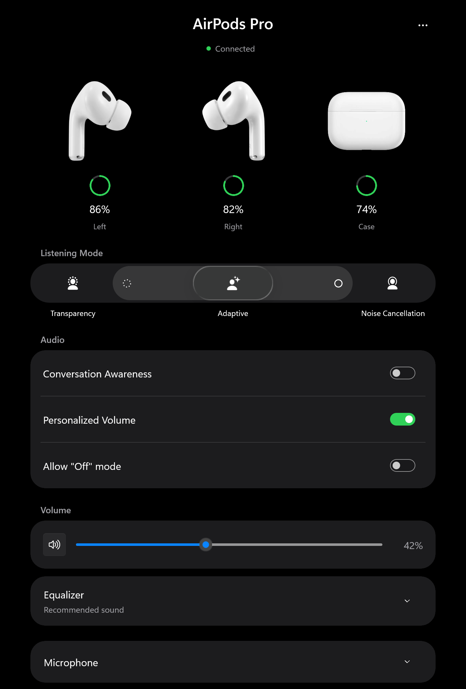
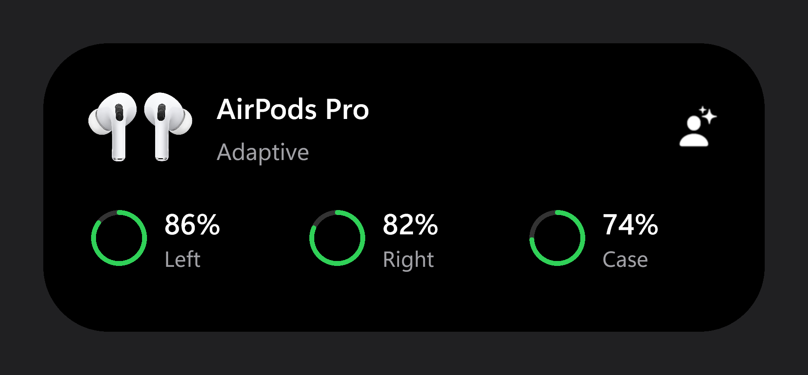

# NTPods

AirPods controls, battery levels and a microphone for Windows 11 x64.
Based on [arctumn/NTPods](https://github.com/arctumn/ntpods) and
[LibrePods](https://github.com/librepods-org/librepods).

> [!WARNING]
> These experimental builds require Windows **Test Mode (test signing)**. The
> drivers are not Microsoft production-signed; setup signs them locally with a
> test certificate. Test Mode weakens Windows' normal driver-signature checks.
> Enabling it for an everyday or work PC is a bad idea. Use a dedicated test PC.
> Secure Boot can block Test Mode, and changing either setting can trigger
> BitLocker recovery. Save your recovery key before changing boot settings.

[Download](https://github.com/Ripthulhu/ntpods/releases) ·
[Installation](#installing-on-windows) ·
[Model support](docs/WINDOWS-MODEL-SUPPORT.md)

## Preview

  <picture>
    <source media="(prefers-color-scheme: light)" srcset="docs/images/app-light.png">
    
  </picture>

### Dynamic Island

Video preview

https://github.com/user-attachments/assets/44b47894-22f6-49f1-a891-99ce0b7346bc

## Features

- Listening-mode controls with an adjustable Adaptive slider.
- Earbud and case battery levels, including nearby charging updates.
- Three-band EQ, Conversation Awareness and Personalized Volume.
- AAC and AAC-ELD playback through one AirPods output, with separate bitrate settings.
- Automatic pause when you remove an earbud. Manually paused audio stays paused.
- A 48 kHz mono microphone on supported models while playback stays stereo,
  with automatic start, a stop delay, keep-active and manual modes, and a keyboard shortcut.
- Live head tracking and heart rate on supported models.
- A Dynamic Island popup and Start with Windows.

### Compatibility

Requires Windows 11 22H2 or newer, x64. Hardware testing covers an Intel AX200
with AirPods Pro 3 and first-generation AirPods Pro. Features and test coverage vary by model;
see [model support](docs/WINDOWS-MODEL-SUPPORT.md) and
[validation](docs/WINDOWS-VALIDATION.md).

Stopping or recovering the high-quality microphone briefly interrupts playback.
For Android or Linux, use [LibrePods](https://github.com/librepods-org/librepods).

## Installing on Windows

Download **NTPods.msi** for guided setup or **NTPods-Windows.zip** for manual installation from
[releases](https://github.com/Ripthulhu/ntpods/releases). Both include the app and
drivers and require Test Mode. Source archives and checksums are included.
See the [installation guide](windows/README.md) and [release notes](docs/WINDOWS-RELEASE-NOTES.md).
Upstream nightly builds do not include this fork's changes.

Both downloads include an experimental playback driver for AirPods 1–4,
Pro 1–3 and the original Max (Lightning and USB-C). See the
[playback model list](docs/WINDOWS-MODEL-SUPPORT.md#native-playback) for test status.
It replaces the paired AirPods output driver, with AAC/AAC-ELD and separate
bitrate settings under **Playback and microphone**. NTPods must stay running
for playback. No extra speaker or per-app routing is needed. Keep the AirPods
connected during uninstall to restore their saved driver, or Windows playback
when no prior binding was saved; see the
[playback test guide](windows/playback/TESTING.md).

With NTPods playback ready and **Use NTPods microphone** enabled, the matching
Windows hands-free microphone and speaker are hidden from audio device lists.
They return when the microphone feature is turned off or NTPods exits. Models
without high-quality microphone support keep their hands-free devices.
Restart Discord if its device list still shows an old entry.

## Contributing

Start with [CONTRIBUTING.md](CONTRIBUTING.md) for the code layout and tests,
or [build the app and drivers](docs/BUILD-WINDOWS.md).

## What's in the repo

- `windows/`: the drivers (AAP, playback and virtual mic), the daemon (Rust), the
  WinUI app (C#) and the installer
- `docs/`: [AirPods protocol reference](docs/AIRPODS-PROTOCOL.md), capture procedure and hardware results
- `.github/workflows/ci-windows.yml`: builds, tests and opt-in experimental packages

## Credits

- [arctumn/NTPods](https://github.com/arctumn/ntpods) for the Windows application,
  daemon, drivers and installer this fork builds on.
- [LibrePods](https://github.com/kavishdevar/librepods) by
  [kavishdevar](https://github.com/kavishdevar) and its contributors for the AirPods
  protocol work. NTPods isn't affiliated with LibrePods.
- [@thibaup](https://github.com/thibaup) (heart rate on Android, LibrePods PR #702)
  and [@SAGIRIxr](https://github.com/SAGIRIxr) for their heart-rate findings.
- [@Gab4545](https://github.com/Gab4545) for building the drivers in CI.
- [pabloaul/apple-wireshark](https://github.com/pabloaul/apple-wireshark) for the
  Wireshark dissectors.

## License

NTPods application code is GPL-3.0, with component-specific notices and an
unresolved microphone-driver licensing issue in [THIRD_PARTY.md](THIRD_PARTY.md).
AirPods is a trademark of Apple Inc. This project isn't affiliated with Apple.
